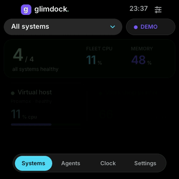
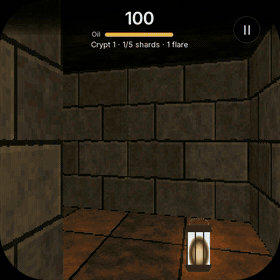
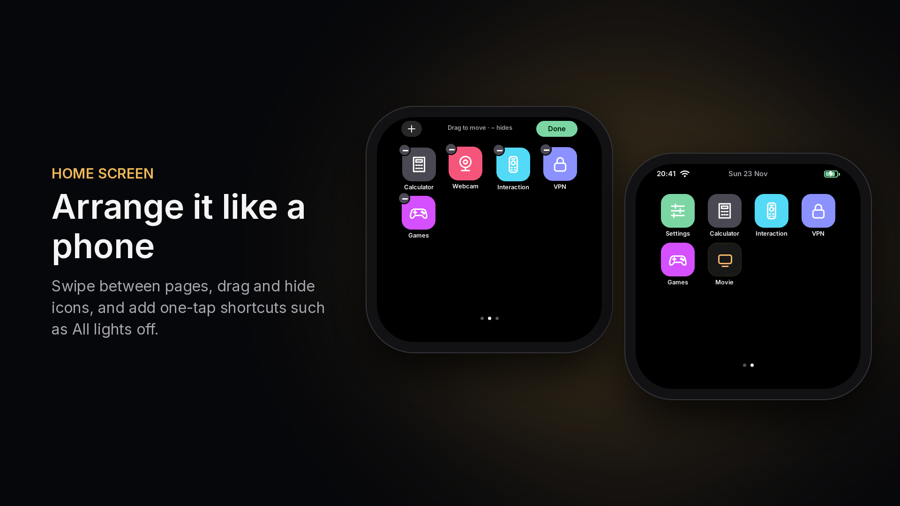
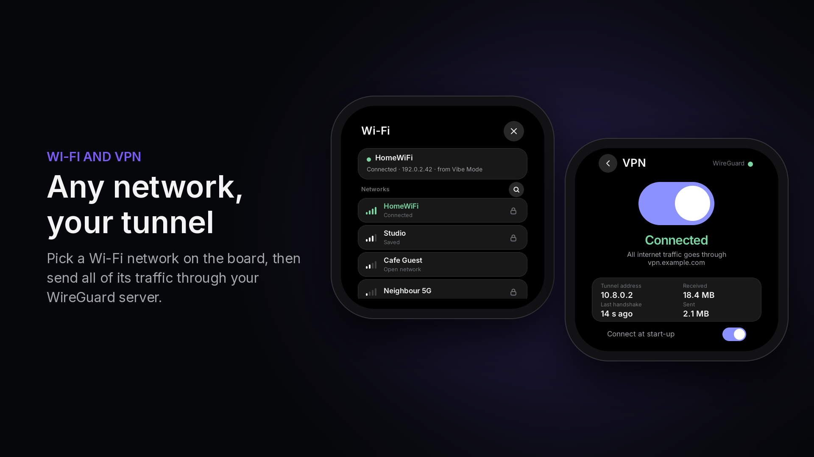
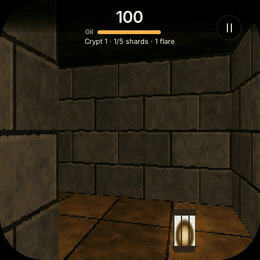
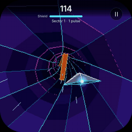
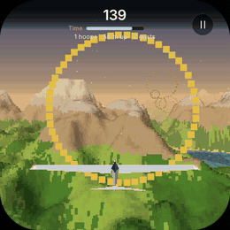
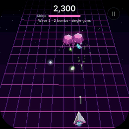
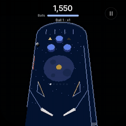
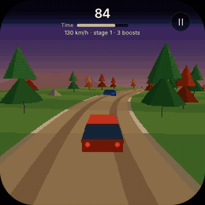

# Glimdock for ESP-Mosaico

A full-screen shell for the [ESP-Mosaico](https://github.com/esp-mosaico) board
(ESP32-S31, 480 × 480 AMOLED): a home screen like a phone's, with a homelab
dashboard, a smart-home wall display, an AI assistant, a camera, a file browser,
a USB webcam, a WireGuard VPN, a set of tools and six retro 3D games, all
native ESP-IDF and LVGL.

It runs as an ordinary ESP-Mosaico Idea: it installs into the application slot
next to Vibe Mode, starts on Vibe Mode's Wi-Fi (or a network you choose in
Settings > Wi-Fi), keeps its storage, and leaves the bootloader, Vibe Mode and
their settings alone.


| Launcher | Glimdock | Swifty | Home | Tools | Games |
| :---: | :---: | :---: | :---: | :---: | :---: |
|  |  |  |  |  |  |

| Home screen and shortcuts | Wi-Fi and VPN |
| :---: | :---: |
|  |  |

A one-minute tour: [docs/media/glimdock-tour.mp4](docs/media/glimdock-tour.mp4).
All of these are rendered from the desktop preview's demo data (`host/media.py`).

## Apps

| App | What it does |
| --- | --- |
| **Glimdock** | Homelab dashboard for a [Glimdock](https://github.com/gkostadinov/glimdock) collector: hosts, services, alerts, operations and the Kordlet agent chat. |
| **Home** | Wall display for a self-hosted [Swifty Home](https://github.com/gkostadinov/swifty-home) hub: rooms, lights and scenes, music, TV, switches, air conditioning (power, temperature, mode, fan), the 3D printer, the pet feeder and litter box, and any other device the hub lists, paired with a one-time display code. What a display may see and control is the hub's choice. |
| **Swifty** | Voice and text assistant: any OpenAI-compatible model, push-to-talk speech recognition over WebSocket (dictations of up to five minutes, which carry on through a dropped connection), optional Tavily web search, and tools to open apps and drive the board (lights, IR TV remote, Interaction board), make shortcuts, and read and message your [Paseo](https://paseo.sh) agents. A developer mode, for profiles allowed it, answers with code. It keeps notes, lists and schedules in its own folder on the NAS (the only place it may write), and sets reminders that come up over any app with a chime and a buzz, once or every day, weekday or week. |
| **Camera** | Viewfinder, filters and photos for the camera module; finds front or rear by itself, gallery (tap for the photo alone, double-tap or pinch to zoom), NAS sync. The same camera signs people in to their profile by face, on the board. |
| **Files** | The board's NAND storage and SMB shares, with image and text previews. |
| **Tools** | Torch, spirit level and compass. |
| **Webcam** | The board as a USB webcam with its microphone (UVC MJPEG 1280 × 720 or 640 × 480, and a UAC2 48 kHz mic; on a Mac, [MosaicoCam](https://github.com/gkostadinov/mosaico-cam) adds filters, upscaling and voice clean-up). |
| **Interaction** | The Interaction module: its buttons, PIR motion, light sensor, six LEDs and an IR remote for the TV. |
| **Calculator** | A four-function calculator. |
| **VPN** | A WireGuard client: while it is on, all of the board's internet traffic, DNS included, goes through your WireGuard server. A big switch, the connection's state in plain words, its address, last handshake and traffic, and connect at start-up. |
| **Games** | Six retro 3D games drawn in software on one small engine, each with a title screen where it plays itself and a best score: **Ember Crypt**, a lantern-lit crawl through ray-cast crypts (gather the shards, keep the ember fed, flare the wisps away); **Starbore**, a flat-shaded neon tunnel flyer (thread the gates, sweep up orbs, pulse a gate away); **Skyglide**, a glider over voxel hills at golden hour (thread the hoops, keep your lift up, dodge the spires, crosswinds and downdrafts of each new stage); **Jellystorm**, a wave shooter against swarms of glowing space jellies (pearls for bigger guns, a pulse bomb, a mother jelly every fourth wave); **Lunar Flip**, a moonbase pinball table (bumpers, slingshots, lanes that raise the multiplier, drop targets, a ball save, nudge and tilt); **Ridge Rally**, a gravel stage through autumn pines against a clock that tightens at every checkpoint (rivals to pass, puddles, rocks and logs, a car that can be wrecked, a boost). About 30 frames a second on the board. Played by touch, or by tilting the board (accelerometer; levelled to however it is held during a short countdown, with a Flip switch for up and down), turning it to look around (gyroscope) and shaking it for each game's action; the Interaction module's buttons and lights join in when it is fitted. Short retro sound effects at Glimdock's sound volume. |
| **Settings** | Profiles (who uses the board and what each may do), Wi-Fi (scan, join with a password, hidden networks, forget), weather (a place or the network's location, °C or °F), brightness, the home screen's hidden apps, the always-on display, haptics, auto-rotate, the panel's corner radius, time zone, camera options and Web settings (servers and keys from a browser). |

Every app works from the board's own settings; nothing points at a particular
server until you configure it.

### Games

| Ember Crypt | Starbore | Skyglide |
| :---: | :---: | :---: |
|  |  |  |
| Gather the shards before the ember's oil runs out | Thread the gates of a twisting neon bore | Ride the thermals through the golden hoops |
| **Jellystorm** | **Lunar Flip** | **Ridge Rally** |
|  |  |  |
| Hold back the glowing swarm, wave after wave | Light the lanes and drop the targets | Gravel, pines and hairpins against the clock |

### Home screen

The icons sit on pages, as on a phone: swipe left and right between them, with
dots at the bottom for the page you are on. Each page holds rows of four icons,
and widgets: half a row or a whole row, on any page.

Widgets show Glimdock's load, Home's lights or music, Swifty, the battery, a
clock, the date, the next reminder, the network (Wi-Fi and the VPN) or the
**weather**: the temperature, the sky, today's high and low and, as a whole row,
the next five hours. The weather comes from [Open-Meteo](https://open-meteo.com)
every 30 minutes for the network's location (the time zone's lookup) or a place
set in Settings or Web settings, and the last forecast shows at once after a
restart.

Hold an icon, or an empty spot, to edit the home screen. The icons jiggle, and:

- **Move** an icon or a widget by dragging it. The others make room. Hold it at the left or
  right edge to turn the page; an empty page waits at the end for a new one.
  Dropping on a full page moves that page's last icon on to the next.
- **Hide** an icon (or remove a widget) with the − at its corner. Settings
  can't be hidden: it is the way back. The **+** at the top left opens the
  widget gallery, and from it the hidden apps; tap one to put it back. Tap a
  widget while editing to change what it shows or its size. **Reset home
  screen** (Settings, Home screen) restores the original arrangement.
- **Done**, or a tap on an empty spot, ends editing.

The arrangement is saved in the board's NVS after every change and survives
restarts and updates. A new app in a later firmware lands at the end of the
last page. Shortcut tiles (one-tap actions) live on the same pages and move
and hide like apps.

### Always-on display

After a while without a touch or the AI key (2 minutes by default; 30 seconds
to 10 minutes, or off, in Settings) the app fades to low light for its last few
seconds (10, or a third of a 30-second wait), as a phone's screen does. Then
the screen becomes a dim clock on black: the time, the date, the next reminder
within a day and the battery. The AMOLED lights only those pixels, at a tenth of
your brightness (2 to 6 %). The clock is drawn once a minute and moves a few
pixels each time against burn-in, and the app under it stops drawing and
polling meanwhile (Glimdock's pages, Home's hub, Swifty's bird). A touch, the AI
key or a due reminder brings back the app as it was, at full light; that touch
or key press does nothing else.

It stays off in the camera's viewfinder, while Swifty listens or answers, and
while a reminder or the screen light is up. In USB webcam mode the screen dims
the same way, down to the clock's light, but the clock stays away: the
webcam's page stays on screen. Wi-Fi stays connected (no modem sleep), so
Glimdock keeps its data current and the AI key starts listening at once.

### Shortcuts

Small programs on the home screen, like Shortcuts on a phone: "All lights off",
"Evening", or your own. A shortcut is a name, an icon, a colour, its steps and
what starts it.

- **Steps**: Swifty Home commands (lights, brightness, colour, scenes, switches,
  the air conditioning, the TV, the speaker, feeding the pet), a **TV remote**
  key from the Interaction module's infrared LED, the Interaction module's
  **lights**, the **screen's brightness**, **open an app**, the
  **flashlight**, **wait**, **show a message**, **run another shortcut** and
  **stop**.
- **Logic**: **if / else if / otherwise** on the time, the day, a device's state
  or temperature, motion or a button on the Interaction module, the light
  level, the Wi-Fi, the VPN, the battery or a variable (with and, or, not);
  **repeat** a number of times or while something holds; **variables** to count
  with.
- **Starts**: a tap on its tile, a time on chosen days, every few minutes within
  hours you choose, sunrise or sunset (for a location set in Web settings), the
  board starting, motion or a button on the Interaction module, or a Swifty
  Home device turning on, off or past a temperature. A switch turns a
  shortcut's automatic starts off.

A tap runs it: the tile shows a spinner, then a tick or a cross, and a toast
says how it went or which step failed. Steps the hub asks to confirm (the TV's
power, Movie) are confirmed by the tap, and asked on screen when nobody tapped.
Limits keep a program from running away (steps, loop rounds, two hours, three
shortcuts deep), and each shortcut keeps a log of its last run.

Make and change them three ways:

- **Web settings**: a block editor with nested ifs and repeats, triggers, and a
  dry-run **Test** that shows each step's log before you save.
- **On the board**: the shortcuts sheet lists them, shows a shortcut's steps,
  starts and last run in words, runs, tests and switches them, and makes the
  common ones in two taps.
- **Swifty**: "turn off the hall lights at 11 on weeknights" (its tools write,
  check, test, run and delete them). A shortcut that would start by itself asks
  you to allow it on the board first.

They are kept on the board (up to 24) and survive restarts and updates; ones
made by earlier versions carry on as they were. Tiles move and hide like apps.

### Profiles

Profiles decide who uses the board and what each may do. Each profile has its
apps (hidden, read-only or full; Glimdock hidden for one profile, Home
read-only for another), what Swifty may do for it (Home, the board's lights and
remote, web search, shortcuts, Paseo, a developer mode for code), and whether
it may change the network or the profiles.

- **Sign-in**: none (Guest), a PIN, a face, or both. **Full mode**, which
  allows the risky things (developer mode, Paseo, and powering machines when
  the collector offers it), always needs a face *and* a PIN. Faces are matched
  on the board by the camera module and never leave it; a slight turn of the
  head keeps a photo out. PINs are stored only as salted hashes, and wrong
  tries wait longer each time.
- **Guest** is what the board shows when nobody is signed in: by default Home
  and Swifty read-only, Tools, the Calculator and Games. The board goes back to
  it after five minutes unused (two in full mode).
- **Set them up** in Settings, Profiles (the badge in the status bar switches
  or locks), or in Web settings. Until a profile exists, the board works as it
  always has. A forgotten PIN is reset over USB from the computer
  (`CONTRIBUTING.md`, RPC 54 · 61).

### Paseo agents

Swifty can work with your [Paseo](https://paseo.sh) agents: "what are my agents
doing?", "what did the homelab agent say?", "tell it to check the NAS disks",
"run the nightly schedule now". It lists agents and their state, reads an
agent's latest activity, sends a message to one or starts one in a workspace,
and lists or runs schedules. Anything that makes an agent act shows a card on
the board first and happens only on a tap.

Set the daemon's address and password in Web settings (Paseo) or in the
`swifty` section of the configuration (`paseo_url`, `paseo_token`, and
`paseo_provider` if Swifty may start new agents). The daemon has to listen on
the network (`paseo daemon config set daemon.listen ...`) with a password set.
That password gives full control of the daemon, so reach it over the VPN or
HTTPS (`paseo_ca` for a private certificate), and allow Paseo only to profiles
that should have it.

### VPN

The VPN app connects to one WireGuard server (a peer, in WireGuard's terms) and,
while it is on, sends all of the board's internet traffic through it: the tunnel
becomes the default route, and DNS goes to the servers the configuration names,
through the tunnel. The local network stays direct (as `wg-quick` leaves it), so
an SMB share or a Swifty Home hub on your LAN is still reached at home. The
tunnel's own packets go straight out over Wi-Fi.

Set it up with a standard WireGuard `.conf` for the board, made on your server
as for any client with `AllowedIPs = 0.0.0.0/0`. Paste it (or pick the file) in
Web settings, or load it with `tools/mosaico-config.py` (`"vpn": {"conf_file":
"~/path/board.conf"}`; the file must be mode 0600). The fields can also be set
one by one. Keys never leave the board: Web settings and `--status` show only
whether each is set, plus the board's own public key, to give the server.

- **While on, nothing goes around the tunnel.** If the server stops answering,
  internet traffic waits until it is back (the app says so in plain words);
  switch the VPN off to use the network directly.
- **Reconnects** by itself after Wi-Fi drops or the server restarts. A server
  given by name is looked up again (over Wi-Fi, with the network's DNS) when
  Wi-Fi comes back or while it does not answer.
- **Connect at start-up** is a switch on the app's screen and in Web settings.
- **A server at home** (on the board's own internet connection) still carries
  the traffic, but the address the internet sees stays your home's: the
  tunnel's counters on the app's screen show the traffic going through.
- **Swifty** can tell the VPN's state and switch it ("turn on the VPN").
- **A 1280-byte tunnel** (MTU) by default, small enough for phone hotspots and
  mobile networks; set another in Web settings or as `MTU =` in the file.
- **Web settings** shows the board's tunnel address as well while the VPN is up.
- **For now:** IPv4 only (IPv6 entries in the file are skipped; the board has no
  IPv6 internet address of its own), one peer, and either everything
  (`0.0.0.0/0`) or the tunnel's own network: other split-tunnel networks are not
  routed. A split tunnel uses the file's DNS servers when they are inside the
  tunnel's network. `PersistentKeepalive = 25` helps behind NAT.

## Hardware

- ESP-Mosaico main board (ESP32-S31, 16 MB flash, PSRAM, 480 × 480 CO5300 AMOLED,
  touch, BMI270, speaker and microphone).
- Optional: the camera module (Camera, webcam) and the Interaction module
  (LEDs, buttons, IR).

## Build and install

Glimdock builds inside an [esp-mosaico-vibe](https://github.com/esp-mosaico/esp-mosaico-vibe)
workspace, which provides ESP-IDF 6.2, the board support package, ESP-Iris and
the `mosaico.py` tool. Set the workspace up as its README describes, then clone
this repository into its `projects/` folder:

```sh
git clone --recurse-submodules https://github.com/esp-mosaico/esp-mosaico-vibe.git
cd esp-mosaico-vibe
git clone https://github.com/gkostadinov/glimdock-mosaico.git projects/glimdock

# Build (in an ESP-IDF 6.2 environment)
idf.py -C projects/glimdock build

# Install into the board's application slot over ESP-Iris (USB or paired Wi-Fi)
python mosaico.py iris app-update --project projects/glimdock
```

`MOSAICO_UTILS_ROOT` in the environment points the build at another
`esp-mosaico-utils` checkout.

### Glimdock's data layer

The Glimdock app compiles Glimdock's own `network.cpp` and model headers from
[`third_party/glimdock`](third_party/glimdock) (MIT). To build against a live
Glimdock checkout instead, set `GLIMDOCK_FIRMWARE_DIR` to its `firmware/` folder.

## Configure

Each app has its own setup on the board. To set everything from a computer in
one go, over ESP-Iris:

```sh
python3 projects/glimdock/tools/mosaico-config.py --template > mosaico.json
# fill in mosaico.json, then:
python3 projects/glimdock/tools/mosaico-config.py --config-file mosaico.json
python3 projects/glimdock/tools/mosaico-config.py --status
```

The file holds keys and passwords: keep it private (mode 0600) and out of version
control. Glimdock's private chat reader is set up with
`tools/private-reader-mosaico.py` (it needs a Glimdock checkout in `GLIMDOCK_DIR`).

Or from a browser: switch on **Web settings** in Settings and open the address it
shows on a computer or phone on the same network, with the six-digit code shown
under it. The page edits the same settings (Swifty, Glimdock, Home pairing, Files
shares, the VPN, the always-on display). Saved keys never leave the board; the page shows only whether each is
set. It is plain HTTP on your network, so switch it on only while you use it: it
turns itself off after 10 minutes unused, after 5 wrong codes and at every
restart.

## Privacy

The board only talks to the servers you configure: your Glimdock collector,
Swifty Home hub, model and speech servers, Tavily, SMB shares and your WireGuard
server. One exception:
with the time zone set to **Automatic**, it asks `ipapi.co` for the time zone of
its public IP address once Wi-Fi is up (and twice a day after that). Pick a time
zone in Settings to turn that off.

Settings and pairings live in the board's NVS and survive updates. The USB webcam
sends video, and reads its microphone, only while a computer has that stream open.

## Development

- **Desktop preview:** `host/render.py` renders the launcher, Glimdock and Home
  to PNGs through LVGL's software renderer. Build the device project once first,
  and set `GLIMDOCK_DIR` to a Glimdock checkout (for its preview shims and demo
  snapshot).
- **Screenshots, GIFs and video:** `host/media.py` turns a recorded preview run
  (`MOSAICO_PREVIEW_RECORD=1`) into the store covers, the GIFs above and the
  tour video. It needs Pillow, ffmpeg and Chrome (for the web settings page).
- **Diagnostics over ESP-Iris** (service `0x4744`): see [CONTRIBUTING.md](CONTRIBUTING.md).
- **Partitions:** `partitions.csv` is the table Vibe Mode 0.4.1 installs; the
  firmware writes only the application slot. `partitions.factory-0.2-layout.csv`
  is the original ESP-Claw factory table, for boards that still have it.

### Layout

| Path | Contents |
| --- | --- |
| `main/` | Entry point: ESP-Iris boot probe, NVS, Recovery, then the shell. |
| `components/mosaico_shell` | Display, touch and LVGL, the board's Wi-Fi (`board_wifi.cpp`; Settings > Wi-Fi is `wifi_settings.cpp`), the home screen (`launcher_apps.cpp` lists its apps, `launcher_layout.cpp` keeps their pages) and Settings, app switching, auto-rotate, haptics, tear-free frame sync, time zone, ESP-Iris services. |
| `components/mosaico_ui` | The shared AMOLED UI kit: Inter fonts, controls, keyboard, icons. |
| `components/glimdock_port` | The Glimdock app on Glimdock's data layer. |
| `components/arduino_compat` | The small Arduino API subset Glimdock's `network.cpp` uses, on ESP-IDF. |
| `components/home_app` | The Swifty Home wall display. |
| `components/swifty_app` | The Swifty assistant: 3D bird, chat, speech, tools. |
| `components/camera_app` | Camera, filters, photos and gallery. |
| `components/files_app` | NAND and SMB file browser. |
| `components/tools_app` | Tools (torch, level, compass) and the Calculator, Interaction and Webcam apps on the same screen. |
| `components/vpn_app` | The VPN: WireGuard ([esphome/wireguard](https://github.com/esphome-libs/wireguard), BSD-3-Clause) with the routing around it, its screen and settings. |
| `components/games_app` | The Games app: the picker and title screens, and six games on one engine (`games_3d.h`: camera, clipping, flat-shaded meshes, particles; plus a ray caster and voxel terrain where those draw a world faster) into a 240 × 240 frame shown doubled. |
| `components/usb_webcam` | USB webcam mode (UVC camera and UAC2 microphone), taking USB over from ESP-Iris while it runs. |
| `components/board_mic` | Who has the board's one microphone: Swifty's speech or the webcam's USB microphone. |
| `components/mosaico_storage` | Mounts Vibe Mode's NAND volume read-write without ever formatting it. |
| `components/app_config` | Reads Vibe Mode's shared Wi-Fi settings. |
| `components/libsmb2` | libsmb2 6.0.0 (LGPL-2.1) for SMB shares. |
| `components/esp_driver_i2c` | ESP-IDF's I2C driver with a fix for the camera probe ([MOSAICO_PATCH.md](components/esp_driver_i2c/MOSAICO_PATCH.md)). |
| `third_party/glimdock` | Glimdock's firmware data layer (MIT). |
| `host/` | Desktop LVGL preview. |
| `tools/` | Configuration, private reader setup, photo download and quality checks. |

## Licence

Apache License 2.0 ([LICENSE](LICENSE)). Third-party parts keep their own
licences; see [NOTICE](NOTICE). In particular, firmware binaries link libsmb2
(LGPL-2.1-or-later) statically: this repository is its complete corresponding
source.
