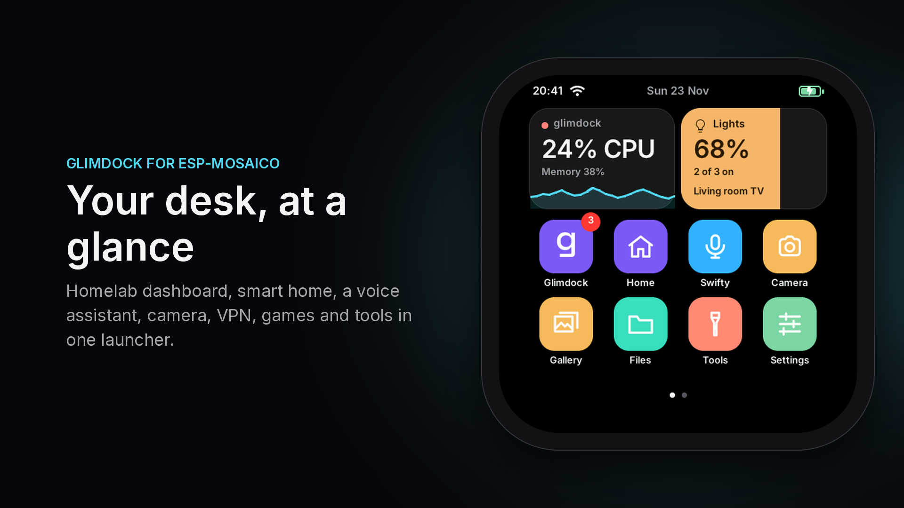
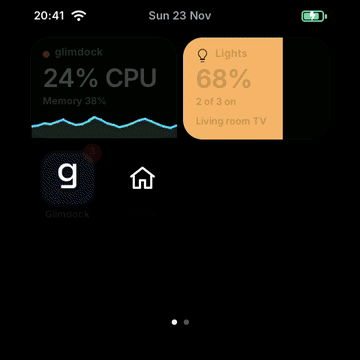
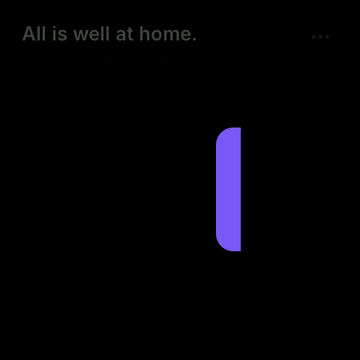
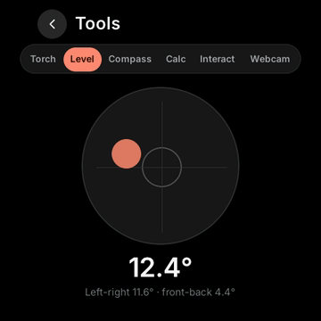

# Glimdock for ESP-Mosaico

A full-screen shell for the [ESP-Mosaico](https://github.com/esp-mosaico) board
(ESP32-S31, 480 × 480 AMOLED): a launcher with a homelab dashboard, a smart-home
wall display, an AI assistant, a camera, a file browser and a set of tools, all
native ESP-IDF and LVGL.

It runs as an ordinary ESP-Mosaico Idea: it installs into the application slot
next to Vibe Mode, keeps Vibe Mode's Wi-Fi and storage, and leaves the
bootloader, Vibe Mode and their settings alone.



| Launcher | Glimdock | Swifty | Home | Tools |
| :---: | :---: | :---: | :---: | :---: |
|  |  |  |  |  |

A 40-second tour: [docs/media/glimdock-tour.mp4](docs/media/glimdock-tour.mp4).
All of these are rendered from the desktop preview's demo data (`host/media.py`).

## Apps

| App | What it does |
| --- | --- |
| **Glimdock** | Homelab dashboard for a [Glimdock](https://github.com/gkostadinov/glimdock) collector: hosts, services, alerts, operations and the Kordlet agent chat. |
| **Home** | Wall display for a self-hosted [Swifty Home](https://github.com/gkostadinov/swifty-home) hub: rooms, lights, music, TV and plugs, paired with a one-time display code. |
| **Swifty** | Voice and text assistant: any OpenAI-compatible model, push-to-talk speech recognition over WebSocket, optional Tavily web search, and tools to open apps and drive the board (lights, IR TV remote, Interaction board). It keeps notes, lists and schedules in its own folder on the NAS (the only place it may write), and sets reminders that come up over any app with a chime and a buzz, once or every day, weekday or week. |
| **Camera** | Viewfinder, filters and photos for the camera module; finds front or rear by itself, gallery (tap for the photo alone, double-tap or pinch to zoom), NAS sync. |
| **Files** | The board's NAND storage and SMB shares, with image and text previews. |
| **Tools** | Torch, spirit level, compass, calculator, the Interaction module (buttons, PIR, light sensor, LEDs, IR remote) and a USB webcam with its microphone (UVC MJPEG 1280 × 720 or 640 × 480, and a UAC2 48 kHz mic; on a Mac, [MosaicoCam](https://github.com/gkostadinov/mosaico-cam) adds filters, upscaling and voice clean-up). |
| **Settings** | Brightness, the always-on display, haptics, auto-rotate, the panel's corner radius, time zone, camera options and Web settings (servers and keys from a browser). |

Every app works from the board's own settings; nothing points at a particular
server until you configure it.

### Always-on display

After a while without a touch or the AI key (2 minutes by default; 30 seconds
to 10 minutes, or off, in Settings) the app fades to low light for its last few
seconds (10, or a third of a 30-second wait), as a phone's screen does. Then
the screen becomes a dim clock on black: the time, the date, the next reminder
within a day and the battery. The AMOLED lights only those pixels, at a tenth of
your brightness (2 to 6 %). The clock is drawn once a minute and moves a few
pixels each time against burn-in, and the app under it stops drawing and
polling meanwhile (Glimdock's pages, Home's hub, Swifty's bird). A touch, the AI
key or a due reminder brings back the app as it was, at full light; that touch
or key press does nothing else.

It stays off in USB webcam mode, in the camera's viewfinder, while Swifty
listens or answers, and while a reminder or the screen light is up. Wi-Fi stays
connected (no modem sleep), so Glimdock keeps its data current and the AI key
starts listening at once.

## Hardware

- ESP-Mosaico main board (ESP32-S31, 16 MB flash, PSRAM, 480 × 480 CO5300 AMOLED,
  touch, BMI270, speaker and microphone).
- Optional: the camera module (Camera, webcam) and the Interaction module
  (LEDs, buttons, IR).

## Build and install

Glimdock builds inside an [esp-mosaico-vibe](https://github.com/esp-mosaico/esp-mosaico-vibe)
workspace, which provides ESP-IDF 6.2, the board support package, ESP-Iris and
the `mosaico.py` tool. Set the workspace up as its README describes, then clone
this repository into its `projects/` folder:

```sh
git clone --recurse-submodules https://github.com/esp-mosaico/esp-mosaico-vibe.git
cd esp-mosaico-vibe
git clone https://github.com/gkostadinov/glimdock-mosaico.git projects/glimdock

# Build (in an ESP-IDF 6.2 environment)
idf.py -C projects/glimdock build

# Install into the board's application slot over ESP-Iris (USB or paired Wi-Fi)
python mosaico.py iris app-update --project projects/glimdock
```

`MOSAICO_UTILS_ROOT` in the environment points the build at another
`esp-mosaico-utils` checkout.

### Glimdock's data layer

The Glimdock app compiles Glimdock's own `network.cpp` and model headers from
[`third_party/glimdock`](third_party/glimdock) (MIT). To build against a live
Glimdock checkout instead, set `GLIMDOCK_FIRMWARE_DIR` to its `firmware/` folder.

## Configure

Each app has its own setup on the board. To set everything from a computer in
one go, over ESP-Iris:

```sh
python3 projects/glimdock/tools/mosaico-config.py --template > mosaico.json
# fill in mosaico.json, then:
python3 projects/glimdock/tools/mosaico-config.py --config-file mosaico.json
python3 projects/glimdock/tools/mosaico-config.py --status
```

The file holds keys and passwords: keep it private (mode 0600) and out of version
control. Glimdock's private chat reader is set up with
`tools/private-reader-mosaico.py` (it needs a Glimdock checkout in `GLIMDOCK_DIR`).

Or from a browser: switch on **Web settings** in Settings and open the address it
shows on a computer or phone on the same network, with the six-digit code shown
under it. The page edits the same settings (Swifty, Glimdock, Home pairing, Files
shares, the always-on display). Saved keys never leave the board; the page shows only whether each is
set. It is plain HTTP on your network, so switch it on only while you use it: it
turns itself off after 10 minutes unused, after 5 wrong codes and at every
restart.

## Privacy

The board only talks to the servers you configure: your Glimdock collector,
Swifty Home hub, model and speech servers, Tavily and SMB shares. One exception:
with the time zone set to **Automatic**, it asks `ipapi.co` for the time zone of
its public IP address once Wi-Fi is up (and twice a day after that). Pick a time
zone in Settings to turn that off.

Settings and pairings live in the board's NVS and survive updates. The USB webcam
sends video, and reads its microphone, only while a computer has that stream open.

## Development

- **Desktop preview:** `host/render.py` renders the launcher, Glimdock and Home
  to PNGs through LVGL's software renderer. Build the device project once first,
  and set `GLIMDOCK_DIR` to a Glimdock checkout (for its preview shims and demo
  snapshot).
- **Screenshots, GIFs and video:** `host/media.py` turns a recorded preview run
  (`MOSAICO_PREVIEW_RECORD=1`) into the store covers, the GIFs above and the
  tour video. It needs Pillow, ffmpeg and Chrome (for the web settings page).
- **Diagnostics over ESP-Iris** (service `0x4744`): see [CONTRIBUTING.md](CONTRIBUTING.md).
- **Partitions:** `partitions.csv` is the table Vibe Mode 0.4.1 installs; the
  firmware writes only the application slot. `partitions.factory-0.2-layout.csv`
  is the original ESP-Claw factory table, for boards that still have it.

### Layout

| Path | Contents |
| --- | --- |
| `main/` | Entry point: ESP-Iris boot probe, NVS, Recovery, then the shell. |
| `components/mosaico_shell` | Display, touch and LVGL, Wi-Fi, the launcher and Settings, app switching, auto-rotate, haptics, tear-free frame sync, time zone, ESP-Iris services. |
| `components/mosaico_ui` | The shared AMOLED UI kit: Inter fonts, controls, keyboard, icons. |
| `components/glimdock_port` | The Glimdock app on Glimdock's data layer. |
| `components/arduino_compat` | The small Arduino API subset Glimdock's `network.cpp` uses, on ESP-IDF. |
| `components/home_app` | The Swifty Home wall display. |
| `components/swifty_app` | The Swifty assistant: 3D bird, chat, speech, tools. |
| `components/camera_app` | Camera, filters, photos and gallery. |
| `components/files_app` | NAND and SMB file browser. |
| `components/tools_app` | Torch, level, compass, calculator, Interaction module, webcam page. |
| `components/usb_webcam` | USB webcam mode (UVC camera and UAC2 microphone), taking USB over from ESP-Iris while it runs. |
| `components/board_mic` | Who has the board's one microphone: Swifty's speech or the webcam's USB microphone. |
| `components/mosaico_storage` | Mounts Vibe Mode's NAND volume read-write without ever formatting it. |
| `components/app_config` | Reads Vibe Mode's shared Wi-Fi settings. |
| `components/libsmb2` | libsmb2 6.0.0 (LGPL-2.1) for SMB shares. |
| `components/esp_driver_i2c` | ESP-IDF's I2C driver with a fix for the camera probe ([MOSAICO_PATCH.md](components/esp_driver_i2c/MOSAICO_PATCH.md)). |
| `third_party/glimdock` | Glimdock's firmware data layer (MIT). |
| `host/` | Desktop LVGL preview. |
| `tools/` | Configuration, private reader setup, photo download and quality checks. |

## Licence

Apache License 2.0 ([LICENSE](LICENSE)). Third-party parts keep their own
licences; see [NOTICE](NOTICE). In particular, firmware binaries link libsmb2
(LGPL-2.1-or-later) statically: this repository is its complete corresponding
source.
